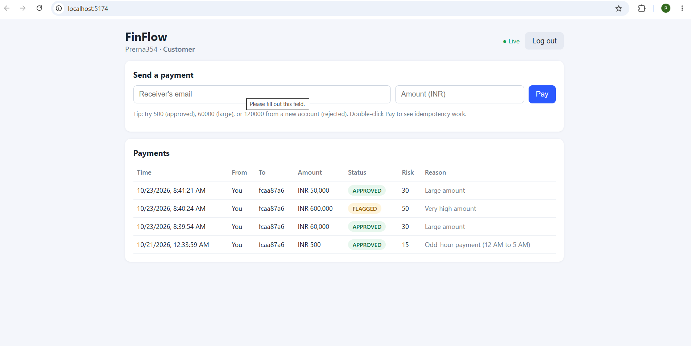

# FinFlow: Distributed Payment & Fraud Detection Platform

A payment platform that moves money safely, stops duplicate payments, and checks every payment for fraud in the background, with live status updates on screen.

**Tech:** Python, FastAPI, React, PostgreSQL, Redis, Celery, WebSockets, Docker

## Screenshot



## Problem

- Users tap "Pay" twice on a slow network and get charged twice.
- Fraudulent payments must be caught, but checking them must not make customers wait.
- Under many requests at once, systems get slow or show wrong data.
- Money data must be protected: only the right people can see or change it, and every action must be traceable.

## Solution

| Problem | FinFlow's answer |
|---|---|
| Duplicate payments | **Idempotency-Key** header + a database unique constraint (one key = one payment) |
| Unauthorized access | **JWT login** + **role-based access control** (customer / analyst / admin) |
| Slow responses | **Redis caching** for payment lists and admin stats |
| Fraud checks slowing users | **Celery workers** run fraud rules in the background |
| Half-done or lost data | **PostgreSQL transactions**: payment + audit log saved together |
| No visibility | **Audit logs** for every important action |
| Not knowing payment status | **WebSocket** pushes PENDING -> APPROVED / FLAGGED / REJECTED live |
| "Works on my machine" | **Docker Compose** runs everything with one command |

## Architecture

```
React (Vite) ──HTTP / WebSocket──> FastAPI ──> PostgreSQL (users, transactions, audit_logs)
                                      │
                                      ├──> Redis (cache + message queue + live-update channel)
                                      │
                                      └──queue task──> Celery worker ──> fraud rules ──> PostgreSQL
                                                              │
                                                              └──publish event──> Redis ──> FastAPI WebSocket ──> React
```

**Life of one payment**
1. User logs in and gets a JWT.
2. User sends `POST /payments` with an `Idempotency-Key`.
3. API checks the token, the key and the receiver, then saves the payment as `PENDING` plus an audit log in one database transaction.
4. API queues a Celery task and replies immediately.
5. The worker scores the payment with the fraud rules and updates the status.
6. The status change is published to Redis, and the WebSocket pushes it to the user's screen.

## Fraud rules (explainable, rule-based)

| Rule | Points |
|---|---|
| Amount >= 1,00,000 | +50 |
| Amount >= 50,000 | +30 |
| 5+ other payments by the same sender in the last minute | +40 |
| Payment between 12 AM and 5 AM (India time) | +15 |
| Account younger than 24 hours sending >= 10,000 | +20 |

Score 70+ is **REJECTED**, 40+ is **FLAGGED** for review, below 40 is **APPROVED**.

## Run it

Needs Docker Desktop.

```bash
cp .env.example .env        # Windows PowerShell: Copy-Item .env.example .env
docker compose up --build
```

| What | Where |
|---|---|
| Web app | http://localhost:5174 |
| API docs (Swagger) | http://localhost:8001/docs |

A first admin is created from `ADMIN_EMAIL` / `ADMIN_PASSWORD` in `.env` (default `admin@finflow.com` / `Admin@12345`). **Change these before deploying anywhere.**

## Quick demo

1. Open http://localhost:5174 and create two accounts (for example Prerna and Rahul). Use two different browsers or a private window for the second user.
2. As Prerna, pay Rahul 500: it becomes **APPROVED** live.
3. Pay 60000 and 120000: see **FLAGGED** and **REJECTED** with reasons.
4. Double-click **Pay** quickly: only one payment is created (idempotency).
5. Log in as the admin: see stats cards. In Swagger, use `PATCH /admin/users/{id}/role` to make someone an analyst.

## API overview

| Method | Path | Who |
|---|---|---|
| POST | `/auth/register`, `/auth/login` | anyone |
| GET | `/users/me`, `/users/lookup?email=` | logged in |
| POST | `/payments` (needs `Idempotency-Key` header) | logged in |
| GET | `/payments`, `/payments/{id}` | logged in (own payments; admin/analyst any) |
| GET | `/admin/transactions`, `/admin/stats` | admin, analyst |
| GET | `/admin/audit-logs` | admin |
| PATCH | `/admin/users/{id}/role` | admin |
| WS | `/ws/transactions?token=...` | logged in |

## Tests

```bash
docker compose exec backend pytest -q
```

Covers the fraud rules and the password/JWT helpers.

## Project structure

```
finflow/
├── docker-compose.yml
├── .env.example
├── backend/
│   └── app/
│       ├── main.py              # app start, CORS, admin seeding
│       ├── core/                # config, security (JWT, hashing), redis
│       ├── db/                  # database session
│       ├── models/              # users, transactions, audit_logs
│       ├── schemas/             # request/response shapes
│       ├── api/                 # deps (auth + RBAC) and routes
│       ├── services/            # fraud rules, cache, events
│       └── workers/             # Celery app and fraud-check task
└── frontend/                    # React + Vite
```

## Known limitations and next steps

- There are no wallet balances yet: payments are recorded and risk-scored, but money is not actually debited or credited.
- Fraud detection is rule-based. A next step is a machine-learning model trained on labelled transactions.
- Database tables are created at startup. For production, switch to Alembic migrations.
- Rate limiting on login and refresh tokens are not added yet.
- The Celery worker does not auto-reload: run `docker compose restart worker` after changing task code.
